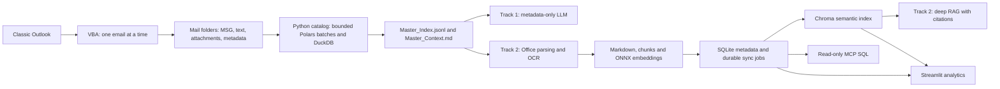

# Outlook Dual-Track RAG

Export Outlook mail into readable folders, process Office documents and images, and query the result
through metadata-only AI, semantic retrieval, SQL/MCP, and an analytics dashboard. Python 3.12+,
uv, Polars, DuckDB, SQLite, Chroma, FastEmbed, and Streamlit form the implementation. The project is
licensed under [MIT](LICENSE); downloaded models keep their own licenses.

Classic Outlook for Windows runs the VBA extractor. Python runs on Windows, Linux, and macOS.
The desktop configuration GUI runs on the host; Docker runs the backend, Chroma, and dashboard.

## Dual-track architecture



| Component | Responsibility |
| --- | --- |
| Track 1 | Allowlisted sender, subject, date, IDs and filenames; bounded metadata sent to an LLM |
| Track 2 | Email text and attachments parsed into Markdown, embedded and retrieved with citations |
| DuckDB + Polars | Disk-backed export catalog and streamed global index generation |
| SQLite | Relational metadata, document revisions, synchronization jobs and analytics |
| Chroma | Semantic vectors for ready document revisions |
| MCP | Deterministic, bounded, read-only queries against curated metadata views |

Track 1 strips legacy body/content fields before sending data to the provider. MSG archives still
contain the full original message, so treat the export folder as sensitive. The freemail filter checks
sender and To/CC/BCC against exact domains and subdomains; it is not a general privacy classifier.

## Install and configure

Install [uv](https://docs.astral.sh/uv/getting-started/installation/) and Tesseract with the OCR language
packs you need. From the checkout:

```sh
uv sync --locked --all-extras --group build
uv run --no-sync outlook-rag init-config --output config.yaml
uv run --no-sync outlook-rag-config --config config.yaml
```

On this cloud workspace set `UV_CACHE_DIR=/workspace/.cache/uv` before uv commands because the home
cache is read-only. Windows users can run the same uv commands in PowerShell without that setting.
`init-config` preserves an existing configuration; use the GUI to edit it. Tk/Tcl must be available in
your Python installation. The base dependencies support configuration editing; model management needs
the `rag` extra. The web dashboard needs the `dashboard` extra.

The GUI saves validated `config.yaml` and a credential-free `extractor.ini`. Secrets belong in an
untracked `.env` or environment variables; see [.env.example](.env.example). `EW_LLM_API_KEY` is needed
only for providers requiring authentication. The HTTP backend requires a strong `EW_API_TOKEN`.
Default answer generation uses Ollama at `http://127.0.0.1:11434/v1`; start Ollama and install a model,
or configure an HTTPS OpenAI-compatible provider. Extraction and catalog generation require no LLM.

## Export from Outlook

Follow [the Outlook installation guide](docs/VBA_INSTALL_GUIDE.md) for the Developer tab, importing the
English [.bas module](src/pipelines/vba_extraction/Outlook_RAG_Extractor.bas), compiling it and running
`ExtractOutlookForRAG`. Select the generated INI when prompted. Start with a small copy-only folder.

Defaults process all dates and subfolders, exclude configured freemail domains and delete nothing.
No PST creation, Outlook item copying or item modification is required in copy mode. Cleanup requires
explicit opt-in, Track 2, a complete Unicode MSG backup, and a default-No confirmation. Python never
deletes mail. Outlook policies can still restrict macros/programmatic access; the guide separates
those cases from filesystem permission failures.

Mail and its attachments remain together for browsing in Explorer, OneDrive or SharePoint:

```text
data/raw/
├── extractor.ini
├── Mail/
│   └── 2026/01/
│       └── 2026-01-15_09-30_Contract renewal_client_7A2B3C4D/
│           ├── Email.msg
│           ├── Email.txt
│           ├── Attachments/
│           │   └── 001 Contract.docx
│           └── _rag/
│               ├── metadata.json
│               ├── source_id.txt
│               └── complete.txt
├── Master_Index.jsonl       # Generated by Python
├── Master_Context.md        # Generated by Python; metadata only
└── _rag/                    # Local DuckDB, locks and publication state
```

Readable date, subject and sender labels accompany a stable identity suffix. Attachment numbering
prevents duplicate names from overwriting each other. Original Outlook folder paths remain in metadata.
The macro checks path length, recursively creates directories, tests write access, and records failures
without aborting the entire mailbox. `Long` counters and per-email completion markers replace the
mailbox-sized in-memory cache. Configuration changes trigger a refreshed export.

Prefer a short local path such as `C:\OutlookRAG`. After extraction/cataloging finish, copy `Mail/`
and the master files into your approved OneDrive/SharePoint library. Keep live DuckDB, SQLite, Chroma
and model caches local; do not synchronize open databases. MSG opens in Outlook from Explorer;
SharePoint/OneDrive browser previews depend on their supported formats.

## Build indexes and ingest

```sh
uv run --no-sync outlook-rag --config config.yaml catalog --batch-size 256
# Install the configured English embedding once; use model selection below for German mail.
uv run --no-sync outlook-rag --config config.yaml models download BAAI/bge-small-en-v1.5
uv run --no-sync outlook-rag --config config.yaml ingest --manifest data/raw/Master_Index.jsonl
uv run --no-sync outlook-rag --config config.yaml sync
uv run --no-sync outlook-rag --config config.yaml search "Vertragsverlängerung" --limit 5
uv run --no-sync outlook-rag --config config.yaml ask "Which contracts expire?" --track 2
uv run --no-sync outlook-rag --config config.yaml ask "Who sent these emails?" --track 1 --metadata-file data/raw/Master_Index.jsonl
uv run --no-sync outlook-rag-dashboard --config config.yaml
```

`catalog` scans complete per-email sidecars, validates contained paths, strips content fields, loads
bounded Polars batches into DuckDB, deduplicates identities and streams both master files. It supports
the previous per-email export layout too. Incomplete exports are counted and return a nonzero status;
invalid metadata/colliding identities leave the prior published catalog intact. Interrupted publication
blocks ingestion until repaired. See [catalog recovery](docs/CATALOG.md).

Supported parsing formats: `.docx`, `.xlsx`, `.pptx`, `.csv`, `.txt`, `.md`, `.jpg`/`.jpeg` and `.png`.
VBA exports `Email.txt` for bodies; Python does not parse `.msg` or legacy binary Office formats.
Tesseract performs image OCR. Size, expanded ZIP and table-row limits are enforced; document macros
are never executed. Track 2 must be enabled to export/ingest bodies and attachments.

SQLite first records pending revisions and durable synchronization jobs. Chroma writes are replayable;
successful sync promotes revisions to ready. SQL views/retrieval exclude pending and stale revisions.
This provides recoverable consistency across stores. Rebuild a lost vector index with
`ingest --force --manifest ...` against preserved raw files. Changing filters does not purge previously
indexed data; retention is a separate operation.

## Discover, download and install models

The GUI has separate Hugging Face dialogs for embeddings and generative LLMs. Discovery fetches
metadata only; weights download only on explicit request. Network work runs in background workers.
Downloads have size budgets and use checked immutable revisions. See [model details](docs/MODELS.md).

```sh
uv run --no-sync outlook-rag models list --language de --online
uv run --no-sync outlook-rag models check sentence-transformers/paraphrase-multilingual-MiniLM-L12-v2
uv run --no-sync outlook-rag models download sentence-transformers/paraphrase-multilingual-MiniLM-L12-v2
uv run --no-sync outlook-rag llm-models list --search Qwen3 --limit 5
uv run --no-sync outlook-rag llm-models check Qwen/Qwen3-4B-GGUF
uv run --no-sync outlook-rag llm-models download Qwen/Qwen3-4B-GGUF --install-ollama --name outlook-rag
```

For German/mixed-language embeddings, supported multilingual MiniLM is a small CPU option
(approximately 0.22 GB in the SDK registry). BGE-small-en remains the English default; Jina's German
model is a larger alternative. Availability, licenses and actual files are checked live. Recommendations
describe resource tradeoffs without claiming benchmark superiority.

Embedding installation validates a real finite CPU vector before marking the cache ready. Pinned
revisions enter the Chroma/ingestion signature. Selecting a different embedding in the GUI creates a
new collection name; reingest raw data. Collections with earlier unpinned signatures also need a new
name after explicit model installation. GGUF downloads verify headers, sizes and available LFS SHA-256
checksums. Ollama import requires an installed, running Ollama service. After import save
`llm.model: outlook-rag` and the indicated local `/v1` URL in GUI/YAML.

## MCP and authenticated API

Configure your MCP client to execute `outlook-rag --config /absolute/path/config.yaml mcp` over stdio.
Tools expose schema, bounded read-only SQL and semantic search. Use only `mcp_emails`, `mcp_documents`
and `mcp_attachments`. SQL AST checks, SQLite authorizer, row limits and time budgets reject writes,
raw tables, CTE view impersonation, extension loading and file access.

```sh
uv run --no-sync outlook-rag --config config.yaml mcp
uv run --no-sync outlook-rag --config config.yaml serve --host 127.0.0.1 --port 8000
```

The API exposes `/health`, `/stats`, `/ingest`, `/search` and `/ask`. Protected requests require
`Authorization: Bearer <your token>`. Ingestion accepts manifests inside the raw root and respects
extraction/catalog locks. Streamlit shows email/document counts, physical vector counts, database
bytes, daily growth, top senders, file types and separate agent controls.

## Docker and standalone deployment

```sh
# First put a strong random EW_API_TOKEN in an untracked .env.
docker compose config --quiet
docker compose up --build -d
# Optional catalog tool: its raw mount must be writable by its configured UID/GID.
docker compose run --rm --no-deps catalog
docker compose exec backend outlook-rag --config /app/config.yaml ingest --manifest /data/raw/Master_Index.jsonl
```

Digest-pinned images, private Chroma networking, non-root containers, read-only application filesystems,
persistent state/model volumes and health checks are included. Ports bind localhost. The catalog tool
has a writable raw mount and no network. On Linux set `EW_CATALOG_UID` and `EW_CATALOG_GID` to the
export directory owner if needed. Backend/dashboard raw mounts remain read-only. Use an authenticated
TLS reverse proxy for remote access.

```sh
uv sync --locked --all-extras --group build
uv run --no-sync python build.py --target all
```

PyInstaller creates GUI, backend/CLI and dashboard bundles under `artifacts/<platform>-<architecture>`.
Distribute the entire bundle, including `_internal`. Build natively on Windows, Linux and macOS;
PyInstaller does not cross-compile. CI builds all three OSes. Tk/Tcl, DuckDB, ONNX and required assets
are collected. Tesseract/language packs and a running LLM remain external prerequisites.
Signing/notarization need your release credentials. See [deployment and backups](docs/DEPLOYMENT.md).

Upgrading from the earlier export layout: use a fresh export directory to avoid conflicting paths
for the same email identity. In older YAML set `extraction.archive_pst: false`; the new extractor
uses independent MSG backups. Choose `date_filter_mode: 0` (all), `1` (before), or `2` (from).

## Repository and verification

[AGENTS.md](AGENTS.md) and `.agent/` define the canonical shape, decisions and current evidence.
Independent slices live in `src/pipelines/`; shared records/ports and adapters in `src/project_name/`.
Composition roots wire components. Five import-linter contracts enforce independence and dependency
direction; there are no global models/services layers.

```sh
uv run --no-sync ruff check
uv run --no-sync ruff format --check
uv run --no-sync mypy
uv run --no-sync lint-imports
uv run --no-sync pytest
uv build
```

Tests use generated mail metadata/documents, real parsers/databases and failure recovery. They never
access or delete a mailbox. [.agent/status.md](.agent/status.md) distinguishes automated checks,
executed model/native/container tests, and external Outlook/OS/provider validation still required.
